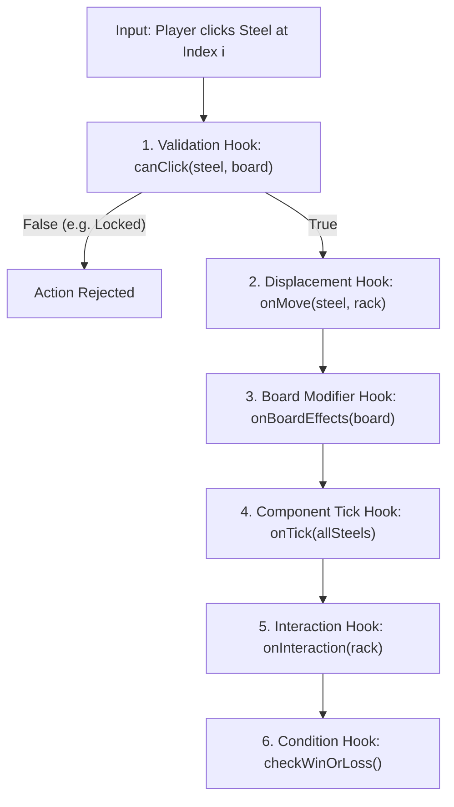

# Hold Steel! — Level Architecture & String Specification Guide

This document defines the core architecture for level representation, level serialization (strings), procedural generation, and game-turn simulation for **Hold Steel!**.

---

## 1. Architectural Philosophy

1. **The Rule of Defaults (Future-Proofing):**
   Every new mechanic, steel variant, board modifier, or game mode must have an implicit default state of **"Off / Standard"**. Old level strings never break when new features are added; new features are simply omitted from older strings.
2. **Single Source of Truth for Simulation:**
   The Game UI and the BFS Level Solver run on the exact same deterministic `stepTurn(state, action)` function. If a mechanic works in the game, the solver and generator understand it automatically.
3. **Decoupled Puzzles (Forward & Reverse Modes):**
   A level fundamentally connects three variables:
   $$\text{Starting Rack } (S_0) \xrightarrow[\text{Actions } (A)]{\text{Board Rules } (B)} \text{Target Blueprint } (S_T)$$
   Whether the player solves for $A$ (Standard Mode) or solves for $S_0$ (Assembly / Setup Mode), the underlying level data structure remains identical.

---

## 2. Level String Specification

Levels are encoded as a modular, human-inspectable string split by pipe delimiters (`|`). Each chunk defines an independent domain of the puzzle.

### 2.1 Grammar & Syntax

```text
HS[version]|[CHUNK_1]|[CHUNK_2]|...|[CHUNK_N]
```

* Prefix: `HS1` (Hold Steel Version 1)
* Standard chunks:
  * `OBJ:[mode]` — Objective / Game Mode
  * `BOARD:[modifier(params)]` — *(Optional)* Board-level modifiers (e.g. Conveyor, Split)
  * `R:[steel_1],[steel_2],...` — Initial Rack Layout (Top $\to$ Bottom)
  * `T:[id_1],[id_2],...` — Target Blueprint Layout (Top $\to$ Bottom)
  * `P:[number]` — Par (Minimum moves required)
  * `A:[action_1],[action_2],...` — Canonical optimal solution path

---

### 2.2 Steel Token Registry

Each steel bar in the `R:` chunk is encoded with: `[CODE][ID]([ATTRIBUTES])`

| Code | Variant Name | Default Syntax | Attributes / Parameters | Description |
| :--- | :--- | :--- | :--- | :--- |
| `S` | Standard Steel | `S0` | None | Basic MTF steel. Moves to top (slot 0). |
| `L` | Locked Steel | `L1` | None | Unclickable. Moved only by cycling others around it. |
| `C` | Counter Steel | `C2(c:3,m:3)` | `c` = current, `m` = max | Decrements by 1 on other clicks. Melts if 0. Click to reset. |
| `D` | Decoy Steel | `D5(c:3)` | `c` = countdown | Must be allowed to melt to 0; absent from Target. |
| `M` | Mirror Steel | `M3` | None | Moves to the **bottom** of the rack instead of top. |
| `P` | Pushy Steel | `P4(exp:0)` | `exp` = expanded (0 or 1) | Expands downward on second click when at top, ejecting bottom. |
| `B` | Bomb Steel | `B6(c:2,rad:1)` | `c` = counter, `rad` = radius | Explosive counter that splits the rack at its slot when 0. |
| `X` | Splitter Steel | `X2(slot:3)` | `slot` = trigger row | Splits the rack into independent sub-boards upon reaching slot. |
| `U` | Comunal Steel | `U0(grp:1)` | `grp` = merge group | Merges into 1 steel when contacting another steel of same color. |
| `K` | Cheeky Steel | `K1(skin:0)` | `skin` = deceptive color | Bluff piece. Moves to a random slot if clicked. |
| `SPO` | Spoiled Steel | `SPO1(slot:2,case:1)` | `slot` = pinned slot, `case` = linked case ID | Pinned to fixed slot. Clicking it teleports & docks it into its Case, becoming permanently locked. |
| `CAS` | Steel Case | `CAS1(holds:1)` | `holds` = linked steel ID | Moveable empty casing that travels in the stack until Spoiled Steel docks inside it. |

> [!NOTE]
> **Extending with New Steels:**
> To add a new steel (e.g., Magnet Steel `MAG`), add a new token definition (`MAG(polar:N)`). The parser splits tokens by name and parentheses, so older level strings and parsers ignore or reject gracefully without structural changes.

---

### 2.3 Board Modifiers (`BOARD:`)

If omitted, the board defaults to a single, stationary vertical rack.

| Board Modifier | Example Syntax | Effect |
| :--- | :--- | :--- |
| **Conveyor Board** | `BOARD:conveyor(dir:up,step:1)` | Shifts every steel on the board up or down by 1 slot every click. |
| **Split Board** | `BOARD:split(slots:[3,6])` | Segregates the rack into 2 or 3 independent sub-racks. |
| **Piston / Limit** | `BOARD:limit(maxSlots:5)` | Fixed slot capacity; steels pushed off bounds are eliminated. |

---

### 2.4 Objective Modes (`OBJ:`)

| Mode | Syntax | Description |
| :--- | :--- | :--- |
| **Play (Standard)** | `OBJ:PLAY` *(Default)* | Player clicks plates to reach the target blueprint. Par indicates target clicks. |
| **Setup (Assembly / Boss)** | `OBJ:SETUP` | Player rearranges the initial rack $S_0$. The game auto-runs the fixed sequence tape in `SEQ:`. |
| **Survive / Clear** | `OBJ:CLEAR` | Eliminate all Decoys or Bomb steels within Par moves. |

---

### 2.5 Concrete String Examples

#### Example 1: Classic Chapter 1 Level (Standard MTF)
```text
HS1|OBJ:PLAY|R:S0,S1,S2,S3|T:2,0,3,1|P:3|A:2,0,2
```

#### Example 2: Mid-Chapter with Counter & Mirror Steels
```text
HS1|OBJ:PLAY|R:S0,C1(c:3,m:3),L2,M3|T:3,0,1,2|P:4|A:3,1,0,3
```

#### Example 3: Future Conveyor Board Mechanic (Zero Parser Rewrite)
```text
HS1|OBJ:PLAY|BOARD:conveyor(dir:up,step:1)|R:S0,C1(c:4,m:4),S2,M3|T:1,3,0,2|P:4|A:1,3,0,1
```

#### Example 4: Chapter Boss Level (Assembly Line / Inverse Mode)
```text
HS1|OBJ:SETUP|R:S0,C1(c:4,m:4),L2,M3|T:3,2,0,1|SEQ:3,0,1,0|P:4|A:1,0,3,2
```
*(In this mode, `SEQ` is shown to the player; `A` contains the required initial rack permutation).*

---

### 2.6 Compact Sharing Code (Base64URL Compression)

To share on social media, chat apps, or via QR code, raw strings can be compressed:
1. `Raw String` $\to$ `Gzip / Deflate Stream` $\to$ `Base64URL Safe`
2. Formatted as: `HS-eJxLtq3m5SpOLM5OL...` (typically 25–45 characters).

---

## 3. The Turn Lifecycle Pipeline

All steel interactions and board mechanics must execute through a strict, multi-stage lifecycle pipeline:



### Lifecycle Stage Details:
1. **Validation (`canClick`):**
   * Checks if the bar is clickable. E.g., `LockedSteel` returns `false`.
2. **Displacement (`onMove`):**
   * `StandardSteel`: Moves to index `0` (top); shifts preceding down.
   * `MirrorSteel`: Moves to index `rack.length - 1` (bottom); shifts following up.
   * `PushySteel`: Toggles expanded state; displaces neighbor.
   * *Active Reset:* If clicked steel has a counter, reset `counter = maxCounter`.
3. **Board Modifiers (`onBoardEffects`):**
   * Executes board-wide shifts (e.g., Conveyor shifts entire rack by $\pm 1$).
4. **Component Ticks (`onTick`):**
   * All *other* counter/bomb plates decrement by 1.
   * Any plate reaching 0 triggers `onExpire(steel)`.
5. **Element Interactions (`onInteraction`):**
   * `ComunalSteel`: Checks adjacent neighbors; merges if color/group matches.
   * Vanished / melted plates are pruned from the rack.
6. **Win / Loss Evaluation:**
   * **Loss:** A required target plate melted or invalid state reached.
   * **Win:** `currentRack.map(s => s.id) === targetBlueprint`.

---

## 4. Procedural Level Generation & BFS Solver

### 4.1 State-Space Serialization
To ensure fast BFS lookups, each state is hashed to an immutable string:
```ts
function serializeState(rack: SteelInstance[], boardState?: any): string {
  const rackKey = rack.map(s => `${s.type}${s.id}:${s.counter ?? '-'}`).join('|');
  const boardKey = boardState ? JSON.stringify(boardState) : '';
  return `${rackKey}#${boardKey}`;
}
```

### 4.2 Generator Algorithm
Levels are generated using **constrained permutation generation + backward/forward validation**:

1. **Chapter Recipe Selection:** Load chapter constraints (e.g. 5 steels, max 1 Counter, max 1 Mirror, Board: Normal).
2. **Sample Random Target Blueprint:** Shuffle target IDs $[0 \dots N-1]$.
3. **Assemble Starting Pool:**
   * Select required steel variants based on chapter weights.
   * Inject optional Decoys or Bombs.
   * Shuffle starting rack $S_0$.
4. **BFS Shortest-Path Search:**
   * Explore reachable state graph (capped at 25,000 states).
   * Prune branches where required steels melt.
   * Record shortest path sequence $[a_1, a_2, \dots, a_k]$.
5. **Quality Filtering:**
   * Ensure $\text{Par} \ge \text{MinDifficulty}$.
   * Discard trivial puzzles (e.g., solved in 1 move or already sorted).
   * Return verified `LevelData` and serialize to string.

---

## 5. Chapter Campaign Structure

```text
Campaign
 └── Chapter 1: Foundations (36 Levels)      --> Focus: Standard & Locked Steels
 └── Chapter 2: The Stopwatch (36 Levels)    --> Focus: Counter Steels & Decoys
 └── Chapter 3: Inversion (36 Levels)        --> Focus: Mirror Steels
 └── Chapter 4: Kinetic Works (36 Levels)    --> Focus: Pushy & Conveyor Board
 └── Chapter 5: Fusion & Fission (36 Levels) --> Focus: Comunal & Splitter Steels
 └── Chapter 6: Assembly Line (36 Levels)    --> Focus: Setup / Reverse Mode
```

### Level 36: Boss Level Archetype
* Levels 1–35 introduce isolated or dual combinations of chapter mechanics with escalating Par.
* Level 36 combines mechanics under high constraint (e.g., *Boss: 1 Conveyor Board + 2 Locked Steels + 1 Bomb Steel + Par 6*).

---

## 6. TypeScript Interface Reference

```ts
export type SteelType = 
  | 'standard' 
  | 'locked' 
  | 'counter' 
  | 'decoy' 
  | 'mirror' 
  | 'pushy' 
  | 'bomb' 
  | 'splitter' 
  | 'comunal' 
  | 'cheeky'
  | 'spoiled'
  | 'case';

export interface SteelInstance {
  id: number;
  type: SteelType;
  counter?: number;
  maxCounter?: number;
  isDecoy?: boolean;
  extra?: Record<string, any>;
}

export interface BoardModifier {
  type: 'none' | 'conveyor' | 'split' | 'limit';
  params?: Record<string, any>;
}

export interface LevelData {
  version: number;
  objective: 'PLAY' | 'SETUP' | 'CLEAR';
  board: BoardModifier;
  initialRack: SteelInstance[];
  target: number[];
  par: number;
  solution: number[];
  givenSequence?: number[]; // Used for OBJ:SETUP
}
```

---

## 7. Migration & Extensibility Checklist

When introducing a new mechanic in the future:
- [ ] Assign a unique 1–3 letter token code (e.g., `MAG` for Magnetic).
- [ ] Define its serialization attributes (e.g., `mag(range:2)`).
- [ ] Implement its corresponding lifecycle hook (`canClick`, `onMove`, `onBoardEffects`, or `onTick`).
- [ ] Add the type to the Chapter Recipe generator so new procedural levels can spawn it.
- [ ] **Do not** touch existing tokens or earlier chapter recipes.

